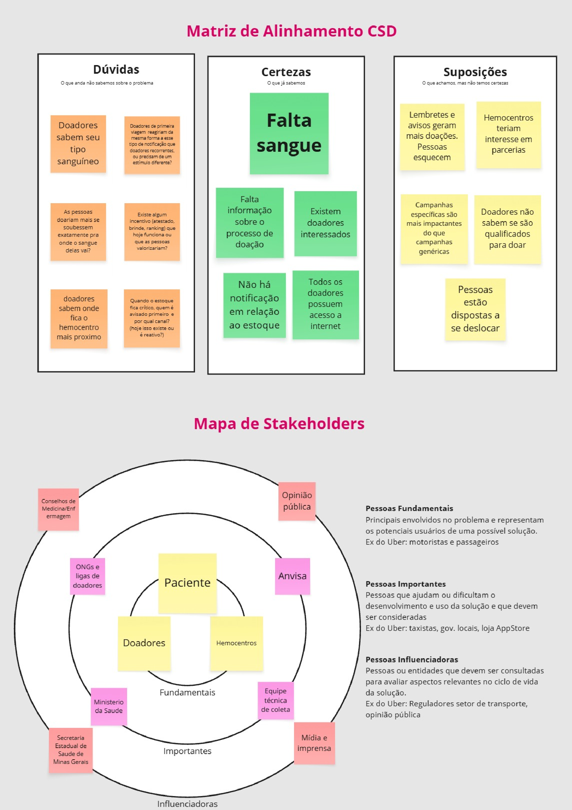
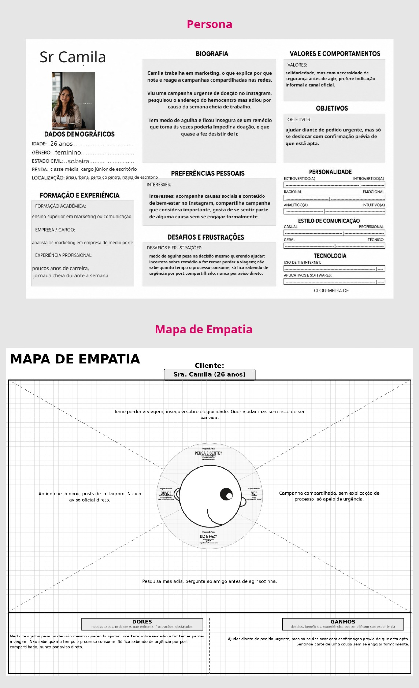
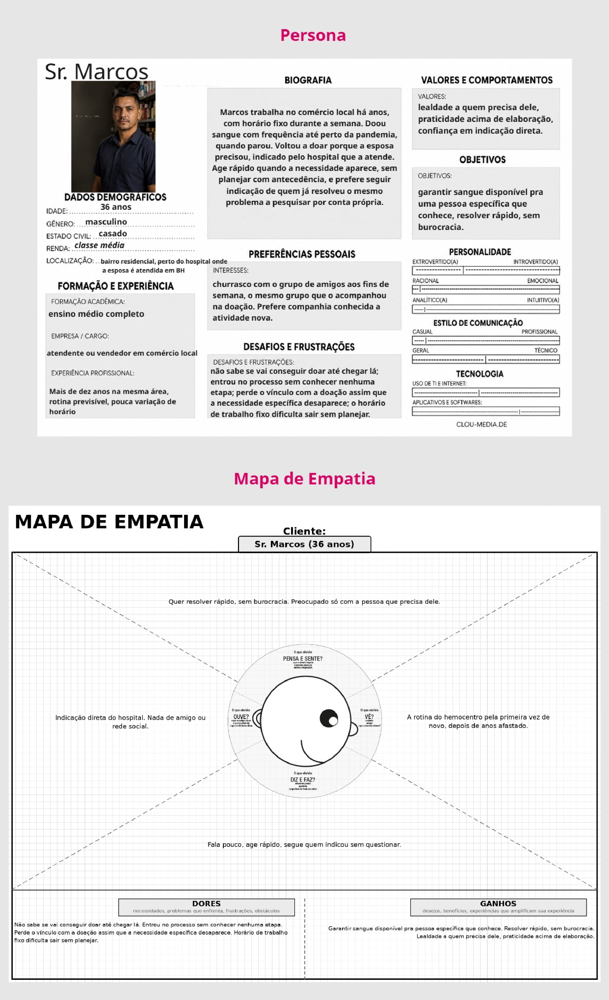
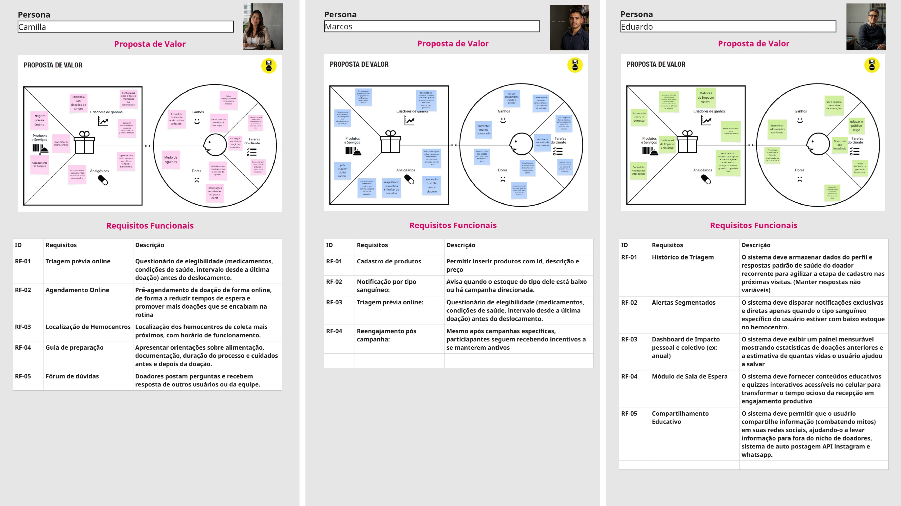

# Introdução

Informações básicas do projeto.

* **Projeto:** DoAção
* **Disciplina:** Trabalho Interdisciplinar 2: Desenvolvimento Centrado no Usuário (Engenharia de Software, PUC Minas)
* **Repositório GitHub:** https://github.com/ICEI-PUC-Minas-PPLES-TI/plf-es-2026-2-ti2-7587100-doacao
* **Membros da equipe:**

  * [Arthur Reis Nametala](https://github.com/Nametala)
  * [Daniel Carneiro de Castro Santos](https://github.com/DanielSantos-lab44)
  * [Gabriel Faria Milan Procópio](https://github.com/GabrielFariaMilanProcopio)
  * [Lucas Araújo Asth](https://github.com/Lucasasth3)
  * [Lucas Fiúza Almeida](https://github.com/Lucasfiuza08)
  * [Matheus Henrique Castilho Ricoy Guerra](https://github.com/Cirker1226)

* **Professores:**

  * Rommel Vieira Carneiro
  * Cleiton Silva Tavares

A documentação do projeto é estruturada da seguinte forma:

1. Introdução
2. Contexto
3. Product Discovery
4. Product Design
5. Metodologia
6. Solução
7. Referências Bibliográficas

[Documentação de Design Thinking (MIRO)](https://miro.com/app/board/uXjVHyO4Fhk=/)

[Documentação de Design Thinking (PDF)](files/processo-dt.pdf)

# Contexto

O DoAção é uma aplicação que aproxima a população dos hemocentros do Brasil. A ideia é oferecer, de forma simples, as informações de que o doador precisa antes de sair de casa e avisá-lo quando a sua doação for realmente necessária.

A doação de sangue é um ato voluntário do qual dependem cirurgias, tratamentos de doenças crônicas e o atendimento a vítimas de acidentes. Como o sangue não pode ser fabricado e tem prazo de validade curto, os hemocentros precisam de um fluxo constante de doadores para manter os estoques em níveis seguros.

Em Minas Gerais, esse equilíbrio tem sido difícil de manter. Em agosto de 2026, a Fundação Hemominas alertou que os estoques estavam cerca de 45% abaixo do esperado no estado (G1, 2026), e o tipo O negativo chegou a ser classificado como crítico (ITATIAIA, 2026). Situações assim se repetem ao longo do ano e, quase sempre, a população só fica sabendo por campanhas pontuais compartilhadas nas redes sociais.

## Problema

Nas entrevistas realizadas, percebemos que a falta de sangue nos pontos de atendimento não é só falta de vontade de ajudar. Muita gente quer doar, mas adia ou desiste por falta de informação. Uma das entrevistadas, por exemplo, contou que viu uma campanha urgente e pesquisou o endereço do hemocentro, mas não foi por medo de descobrir, já no local, que um remédio que toma a impediria de doar.

O problema pode ser resumido assim:

> Potenciais doadores não sabem onde, quando e como doar, têm dúvidas sobre se estão aptos e não são avisados quando os estoques estão baixos. Por isso, deixam de doar ou doam apenas de forma esporádica, o que contribui para a falta de sangue nos hemocentros de Minas Gerais.

O problema aparece de formas diferentes para cada tipo de doador. Algumas pessoas deixam de ir por medo de não poder doar. Outras só se mobilizam quando alguém próximo precisa e, depois, não voltam. Já os doadores frequentes reclamaram de responder à mesma triagem a cada visita e de não receber avisos voltados ao seu tipo sanguíneo.

## Objetivos

**Objetivo geral:** aumentar a doação de sangue em Minas Gerais e no Brasil por meio da redução das barreiras de informação que dificultam a ida e a permanência dos doadores nos hemocentros.

Como objetivos específicos, o projeto busca:

- Permitir que o usuário verifique, antes de sair de casa, se está apto a doar, por meio de uma pré-triagem online;
- Facilitar a localização de hemocentros próximos e o agendamento da doação;
- Notificar os doadores de forma segmentada, de acordo com o tipo sanguíneo e o nível dos estoques;
- Explicar o processo de doação em linguagem simples, reduzindo o medo e a insegurança de quem nunca doou;
- Incentivar a recorrência das doações, mostrando ao doador o impacto das suas contribuições e quando ele poderá doar novamente.

## Justificativa

A escassez de sangue é um problema recorrente e com impacto direto na saúde pública: quando os estoques caem, cirurgias eletivas são adiadas e pacientes que dependem de transfusões ficam em risco. As notícias usadas como referência mostram que a situação em Minas Gerais chegou a níveis críticos em 2026 (G1, 2026; ITATIAIA, 2026; TV SIM BRASIL, 2026).

Ao mesmo tempo, as entrevistas mostraram pessoas dispostas a doar que não doam porque não recebem a informação no momento certo. Por isso, o grupo acredita que uma solução digital faz sentido aqui. Ela pode reunir informações que hoje estão espalhadas, tirar dúvidas que normalmente só são resolvidas na triagem presencial e ligar diretamente a necessidade dos hemocentros a quem pode ajudar. Mesmo um pequeno aumento no retorno dos doadores já faz diferença, porque cada doação pode ajudar mais de um paciente.

## Público-Alvo

O público-alvo do DoAção são pessoas residentes em Minas Gerais, que estão dentro da faixa etária permitida para doação (16 a 69 anos) e que têm acesso a um smartphone ou computador.

Dentro desse grupo, foram identificados três perfis principais, que deram origem às personas:

- **Doadores iniciantes ou eventuais**, que querem ajudar, mas têm dúvidas sobre o processo e sobre a própria aptidão;
- **Doadores mobilizados por uma necessidade específica**, como a de um familiar internado, que tendem a não voltar depois que essa necessidade passa;
- **Doadores recorrentes e engajados**, que já conhecem o processo e buscam agilidade e informações sobre o impacto das suas doações.

A solução também atende os hemocentros e hospitais, que passam a ter um canal para comunicar a necessidade de sangue a um público já interessado em doar.

# Product Discovery

## Etapa de Entendimento

Para compreender com maior profundidade o problema, o grupo seguiu o processo proposto pela disciplina, que combina Design Thinking e desenvolvimento ágil. Na etapa de empatia foram produzidos a matriz CSD, o mapa de stakeholders, o roteiro e as entrevistas qualitativas com doadores e profissionais da área, e os highlights de pesquisa. Todos os artefatos estão registrados no quadro do projeto no Miro.

A **Matriz de Alinhamento (CSD)** foi construída no início da fase de empatia. Nela, organizamos o que já sabíamos sobre o problema (certezas), o que achávamos, mas ainda não tínhamos confirmado (suposições), e o que precisávamos descobrir (dúvidas). As dúvidas e suposições serviram de base para o roteiro das entrevistas.

## Etapa de Definição

### Personas

A partir das entrevistas qualitativas, foram construídas três personas, cada uma representando um dos perfis de público-alvo. Junto com cada uma, há um mapa de empatia que organiza o que ela pensa e sente, ouve, vê, fala e faz, além das suas dores e dos ganhos que espera. As figuras foram retiradas do quadro do projeto no Miro.

#### Persona 1: Camila

Camila tem 26 anos, é solteira e trabalha como analista de marketing em uma empresa de médio porte, com jornada cheia durante a semana. Por causa da profissão, nota e reage a campanhas compartilhadas nas redes sociais. Viu uma campanha urgente de doação no Instagram, pesquisou o endereço do hemocentro, mas adiou a ida por causa da semana cheia. Tem medo de agulha e ficou insegura sobre se um remédio que toma às vezes poderia impedir a doação, o que quase a fez desistir.

**Objetivos e necessidades:** quer ajudar diante de um pedido urgente, mas só aceita se deslocar se tiver a confirmação prévia de que está apta. Valoriza a solidariedade, mas precisa se sentir segura antes de agir e prefere indicações informais a canais oficiais.

| Dimensão | Descrição |
| -------- | --------- |
| **Pensa e sente** | Teme perder a viagem e está insegura sobre a própria elegibilidade. Quer ajudar, mas sem o risco de ser barrada. |
| **Ouve** | Amigos que já doaram e posts do Instagram. Nunca recebe um aviso oficial direto. |
| **Vê** | Campanhas compartilhadas sem explicação do processo, apenas com apelo de urgência. |
| **Fala e faz** | Pesquisa, mas adia. Pergunta a um amigo antes de agir sozinha. |
| **Dores** | O medo de agulha pesa na decisão, mesmo querendo ajudar; a incerteza sobre o remédio a faz temer perder a viagem; não sabe quanto tempo o processo consome; só fica sabendo de urgências por posts compartilhados, nunca por aviso direto. |
| **Ganhos** | Ajudar diante de um pedido urgente, desde que tenha confirmação prévia de que está apta; sentir-se parte de uma causa sem precisar se engajar formalmente. |

#### Persona 2: Marcos

Marcos tem 36 anos, é casado, tem ensino médio completo e trabalha há mais de dez anos no comércio local, com horário fixo durante a semana. Mora em um bairro residencial perto do hospital onde a esposa é atendida, em Belo Horizonte. Doou sangue com frequência até perto da pandemia, quando parou. Voltou a doar porque a esposa precisou, por indicação do hospital. Age rápido quando a necessidade aparece, sem planejar com antecedência, e prefere seguir a indicação de quem já resolveu o mesmo problema a pesquisar por conta própria.

**Objetivos e necessidades:** quer garantir sangue disponível para uma pessoa específica que conhece e resolver isso rápido, sem burocracia. Valoriza a lealdade a quem precisa dele, prefere praticidade a elaboração e confia em indicações diretas.

| Dimensão | Descrição |
| -------- | --------- |
| **Pensa e sente** | Quer resolver rápido, sem burocracia. Está preocupado apenas com a pessoa que precisa dele. |
| **Ouve** | A indicação direta do hospital. Não recebe nada de amigos ou redes sociais. |
| **Vê** | A rotina do hemocentro pela primeira vez em muito tempo, depois de anos afastado. |
| **Fala e faz** | Fala pouco, age rápido e segue quem o indicou sem questionar. |
| **Dores** | Não sabe se vai conseguir doar até chegar ao local; entrou no processo sem conhecer nenhuma etapa; perde o vínculo com a doação assim que a necessidade específica desaparece; o horário de trabalho fixo dificulta sair sem planejar. |
| **Ganhos** | Garantir sangue disponível para a pessoa que conhece; resolver rápido e sem burocracia. |

#### Persona 3: Eduardo

Eduardo tem 52 anos, é casado, mora em Belo Horizonte e é educador em saúde pública. Já doou sangue mais de 30 vezes e dá palestras semanais corrigindo mitos sobre a doação. Relativiza o próprio desconforto físico diante do impacto que a doação causa. Pensa o problema de forma sistêmica: critica a gestão institucional, mas elogia a equipe de atendimento.

**Objetivos e necessidades:** quer ver o impacto direto e mensurável das suas doações e saber quando o seu tipo sanguíneo está em falta. Também quer transformar o próprio engajamento em alcance, levando informação a quem está fora do meio da doação, e ver a gestão do hemocentro aproveitar melhor o tempo dos doadores recorrentes. Valoriza impacto mensurável, coerência entre discurso e prática e reconhecimento de quem trabalha bem.

| Dimensão | Descrição |
| -------- | --------- |
| **Pensa e sente** | Quer que o seu esforço tenha impacto visível. Incomoda-se com uma gestão que desperdiça engajamento como o dele. |
| **Ouve** | Elogios e dúvidas de quem assiste às suas palestras e críticas informais sobre a gestão do hemocentro. |
| **Vê** | Sala de espera ociosa, campanhas genéricas e uma equipe de atendimento que considera boa, apesar da gestão. |
| **Fala e faz** | Corrige mitos em público, usa a própria experiência como argumento e critica a gestão abertamente. |
| **Dores** | Recebe só campanhas genéricas quando queria alertas específicos para o seu tipo sanguíneo; vê o tempo da sala de espera desperdiçado; responde ao mesmo questionário de triagem a cada visita; vê pessoas fora do meio da doação sem acesso a nenhuma informação. |
| **Ganhos** | Ver o impacto direto da própria doação; levar informação a quem está fora do meio da doação; reconhecimento de quem trabalha bem e coerência entre discurso e prática. |

#### Síntese das personas

Apesar de perfis diferentes, as três personas compartilham uma mesma necessidade: receber a informação certa no momento certo. Camila precisa saber se está apta antes de sair de casa; Marcos precisa saber se vai conseguir doar antes de sair e de um motivo para continuar doando quando a necessidade da esposa passar; Eduardo precisa de agilidade e de avisos direcionados ao seu tipo sanguíneo. Foi essa conclusão que guiou a proposta de valor do DoAção e, a partir dela, os requisitos apresentados a seguir.

# Product Design

Essa fase envolve a definição de uma proposta de valor, a especificação e priorização das funcionalidades e a consequente criação de wireframes e protótipos que detalham a interface e a experiência do usuário.

## Proposta de Valor

A especificação do projeto foi elaborada a partir da proposta de valor de cada persona, feita no Miro.

## Especificação do Projeto

Como algumas necessidades se repetiam entre as personas, elas foram reunidas em uma lista única, sem repetições. Cada requisito funcional indica a persona que o originou e a prioridade definida na etapa de priorização.

### Requisitos Funcionais

| ID | Requisito | Descrição | Persona | Prioridade |
| -- | --------- | --------- | ------- | ---------- |
| RF-01 | Cadastro e perfil do doador | Permitir que o usuário cadastre e edite seus dados pessoais, incluindo data de nascimento e tipo sanguíneo. | Todas | Alta |
| RF-02 | Pré-triagem online | Oferecer um questionário de elegibilidade (medicamentos, condições de saúde, intervalo desde a última doação) que informe ao usuário, antes do deslocamento, se ele pode doar. | Camila, Marcos | Alta |
| RF-03 | Agendamento online | Permitir que o usuário agende a doação em um hemocentro, escolhendo data e horário disponíveis. | Camila | Alta |
| RF-04 | Alertas segmentados | Enviar notificações apenas quando o tipo sanguíneo do usuário estiver com estoque baixo ou houver campanha direcionada a ele. | Marcos, Eduardo | Alta |
| RF-05 | Localização de hemocentros | Exibir os hemocentros mais próximos em um mapa, com endereço, distância e horário de funcionamento. | Camila | Alta |
| RF-06 | Histórico de triagem | Armazenar as respostas estáveis da última triagem para agilizar as próximas, pedindo ao usuário apenas a confirmação do que pode ter mudado. | Eduardo | Média |
| RF-07 | Controle de intervalo entre doações | Informar ao usuário quando ele poderá doar novamente e lembrá-lo quando o intervalo mínimo for cumprido. | Marcos, Eduardo | Média |
| RF-08 | Painel de impacto | Exibir ao usuário o número de doações realizadas, o volume doado e a estimativa de vidas ajudadas. | Eduardo | Média |
| RF-09 | Guia passo a passo da doação | Apresentar conteúdo informativo, em linguagem simples, sobre as etapas da doação e os critérios de aptidão. | Camila | Média |
| RF-10 | Pedidos de doação | Permitir que pacientes ou familiares publiquem pedidos de doação vinculados a um hospital e que outros usuários os visualizem e compartilhem. | Marcos | Baixa |
| RF-11 | Fórum de dúvidas | Permitir que usuários publiquem perguntas e recebam respostas de outros usuários ou da equipe. | Camila | Baixa |
| RF-12 | Quiz educativo | Oferecer quizzes interativos sobre doação, que podem ser usados inclusive durante a espera no hemocentro. | Camila, Eduardo | Baixa |
| RF-13 | Eventos e campanhas | Listar campanhas e eventos de doação, com data, local e número de participantes. | Eduardo | Baixa |
| RF-14 | Compartilhamento em redes sociais | Permitir que o usuário compartilhe campanhas e informações sobre doação nas redes sociais. | Eduardo | Baixa |
| RF-15 | Reengajamento pós-campanha | Enviar incentivos a quem participou de uma campanha específica, para que continue doando depois dela. | Marcos | Baixa |

### Requisitos Não Funcionais

Os requisitos não funcionais definem qualidades que o sistema deve ter, independentemente da funcionalidade utilizada.

| ID | Requisito | Descrição |
| -- | --------- | --------- |
| RNF-01 | Responsividade | A aplicação deve se adaptar a telas de celulares, tablets e computadores. |
| RNF-02 | Usabilidade | As tarefas principais (pré-triagem e agendamento) devem poder ser concluídas sem treinamento, com linguagem simples e sem termos técnicos. |
| RNF-03 | Segurança e privacidade | Dados pessoais e de saúde devem ser protegidos, com senhas armazenadas de forma criptografada, em conformidade com a Lei Geral de Proteção de Dados (LGPD). |
| RNF-04 | Disponibilidade | A aplicação deve estar publicada em um ambiente acessível publicamente na internet e disponível 24 horas por dia, 7 dias por semana. |
| RNF-05 | Desempenho | As páginas principais devem carregar em até 3 segundos em uma conexão móvel 4G. |
| RNF-06 | Acessibilidade | As telas devem ter contraste adequado, textos alternativos em imagens e tamanho de fonte legível. |

### Restrições

As restrições são limitações impostas ao projeto que a equipe não pode alterar.

| ID | Restrição |
| -- | --------- |
| R-01 | O projeto deve ser desenvolvido e entregue dentro do calendário do Trabalho Interdisciplinar 2, no segundo semestre de 2026. |
| R-02 | O sistema deve ser desenvolvido com as tecnologias definidas pela disciplina (aplicação web, API, banco de dados e hospedagem em plataforma PaaS) e versionado no repositório GitHub da disciplina. |
| R-03 | Nesta versão não haverá integração com os sistemas oficiais da Fundação Hemominas; os dados de hemocentros e estoques serão cadastrados ou simulados pela equipe. |
| R-04 | A pré-triagem online tem caráter apenas orientativo e não substitui a triagem clínica realizada presencialmente no hemocentro. |

## Priorização das Funcionalidades

Os requisitos foram priorizados no Miro usando uma matriz com quatro categorias: **obrigatórias** (sem elas o produto não resolve o problema), **importantes** (agregam muito valor, mas o produto funciona sem elas), **desejáveis** (melhoram a experiência) e **opcionais** (podem ficar para versões futuras). O critério principal foi o quanto cada funcionalidade resolve as dores mais citadas nas entrevistas: a dúvida sobre a aptidão, a falta de avisos e a dificuldade de encaixar a doação na rotina.

O resultado está organizado no Kanban de funcionalidades abaixo. Cada coluna corresponde a uma categoria, e a ordem de implementação segue da esquerda para a direita.

| Obrigatórias | Importantes | Desejáveis | Opcionais |
| ------------ | ----------- | ---------- | --------- |
| RF-01 Cadastro e perfil do doador | RF-06 Histórico de triagem | RF-10 Pedidos de doação | RF-13 Eventos e campanhas |
| RF-02 Pré-triagem online | RF-07 Controle de intervalo entre doações | RF-11 Fórum de dúvidas | RF-14 Compartilhamento em redes sociais |
| RF-03 Agendamento online | RF-08 Painel de impacto | RF-12 Quiz educativo | RF-15 Reengajamento pós-campanha |
| RF-04 Alertas segmentados | RF-09 Guia passo a passo da doação | | |
| RF-05 Localização de hemocentros | | | |

As funcionalidades obrigatórias formam o fluxo central do DoAção: o usuário se cadastra, verifica se está apto, encontra um hemocentro, agenda a doação e passa a receber avisos quando for necessário. As importantes reforçam a recorrência, que é o segundo objetivo do projeto. As desejáveis e opcionais tratam de comunidade e engajamento, e serão implementadas conforme o tempo disponível nas sprints.

## Projeto de Interface

Artefatos relacionados com a interface e a interação do usuário na proposta de solução. Os wireframes e o protótipo interativo foram feitos no Figma.

[Wireframes e fluxo no Figma](https://www.figma.com/design/njJzqfUmrD8CigO7nbO1EH/Doação-de-sangue-Wireframes-e-fluxo)

### Wireframes

[Wireframe do Projeto](https://www.figma.com/design/njJzqfUmrD8CigO7nbO1EH/Doa%C3%A7%C3%A3o-de-sangue-%E2%80%94-Wireframes-e-fluxo?node-id=0-1)

### User Flow

[Userflow do Projeto](https://www.figma.com/design/njJzqfUmrD8CigO7nbO1EH/Doa%C3%A7%C3%A3o-de-sangue-%E2%80%94-Wireframes-e-fluxo?node-id=12-13)

### Protótipo Interativo

[Prototipo Interativo](https://marvelapp.com/prototype/d4f07df/screen/99058085)

# Metodologia

Detalhes sobre a organização do grupo e o ferramental empregado.

## Abordagem de Trabalho

O projeto segue o processo proposto pela disciplina, que combina Design Thinking e desenvolvimento ágil.

Na fase de **Design Thinking**, passamos pelas etapas de:

- **Empatia:** matriz CSD, mapa de stakeholders, roteiro e entrevistas qualitativas, highlights de pesquisa;
- **Definição:** personas, mapas de empatia e proposta de valor;
- **Ideação:** requisitos e priorização;
- **Prototipagem:** wireframes, user flow e protótipo interativo.

Na fase de **desenvolvimento ágil**, o sistema será construído em três sprints:

1. **Sprint 1:** layout e cadastros;
2. **Sprint 2:** fluxos principais (pré-triagem, agendamento e alertas);
3. **Sprint 3:** integração, testes e avaliação final, seguida da implantação e da apresentação.

A equipe se reúne toda semana, presencialmente ou online, para revisar o andamento das tarefas e dividir as próximas. No dia a dia, a comunicação acontece pelo grupo de WhatsApp e pelo Discord(Com transmissão pelo Google Meet) .

## Ferramentas

Relação de ferramentas empregadas pelo grupo durante o projeto.

| Ambiente | Plataforma | Link de acesso |
| -------- | ---------- | -------------- |
| Editor de Código | Visual Studio Code | [PREENCHER] |
| Repositório de código | GitHub | https://github.com/ICEI-PUC-Minas-PPLES-TI/plf-es-2026-2-ti2-7587100-doacao |
| Processo de Design Thinking | Miro | https://miro.com/app/board/uXjVHyO4Fhk=/ |
| Wireframes e Protótipo Interativo | Figma | https://www.figma.com/design/njJzqfUmrD8CigO7nbO1EH/Doação-de-sangue-Wireframes-e-fluxo |
| Controle de tarefas (Kanban) | GitHub Projects | https://github.com/orgs/ICEI-PUC-Minas-PPLES-TI/projects/914 |
| Comunicação | WhatsApp | Grupo interno |
| Comunicação | Discord | Grupo interno |

## Divisão de Papéis

Todos os integrantes participaram das atividades coletivas no Miro. A tabela abaixo mostra as principais contribuições de cada um até agora e o papel previsto para a fase de desenvolvimento, que ainda não começou.

| Integrante | Principais contribuições até agora | Papel previsto no desenvolvimento |
| ---------- | ---------------------------------- | --------------------------------- |
| Arthur Reis Nametala | Condução das etapas de Design Thinking; entrevistas qualitativas; apoio na criação dos wireframes. | Banco de dados e Front-end |
| Daniel Carneiro de Castro Santos | Entrevistas qualitativas; elaboração do pitch deck e da apresentação; organização das reuniões da equipe. | Back-end e API |
| Gabriel Faria Milan Procópio | Matriz CSD e mapa de stakeholders; apoio na consolidação dos requisitos. | Banco de dados |
| Lucas Araújo Asth | Entrevistas qualitativas; descrição do minimundo. | Back-end e API |
| Lucas Fiúza Almeida | Entrevistas qualitativas; documentação do projeto. | Documentação e testes |
| Matheus Henrique Castilho Ricoy Guerra | Responsável pelos wireframes e pelo protótipo no Figma. | Front-end e UI |

## Gerenciamento do Projeto

As tarefas são acompanhadas em um quadro Kanban no GitHub Projects, vinculado ao repositório do projeto, com as colunas **A fazer**, **Em andamento** e **Concluído**. Cada tarefa é registrada como uma issue no repositório (15 no total, de #1 a #15), com descrição e responsáveis.

* Quadro Kanban: https://github.com/orgs/ICEI-PUC-Minas-PPLES-TI/projects/914
* Issues: https://github.com/ICEI-PUC-Minas-PPLES-TI/plf-es-2026-2-ti2-7587100-doacao/issues

Situação do quadro no momento da entrega da fase de Concepção: com o fim da fase de Design Thinking, todas as tarefas de pesquisa, definição e prototipagem estão concluídas, e as próximas tarefas são as sprints de desenvolvimento, que ainda não começaram.

| Status | Tarefa | Responsáveis |
| ------ | ------ | ------------ |
| A fazer | Sprint 1: layout responsivo e cadastros (RF-01) | Front-end e back-end |
| A fazer | Sprint 2: pré-triagem, agendamento e alertas (RF-02 a RF-05) | Equipe |
| A fazer | Sprint 3: funcionalidades importantes, integração e testes | Equipe |
| A fazer | Implantação em plataforma PaaS | Back-end |
| A fazer | Apresentação final | Equipe |
| Concluído | Matriz CSD e mapa de stakeholders | Gabriel e equipe |
| Concluído | Roteiro e entrevistas qualitativas | Arthur, Daniel, Lucas Asth e Lucas Fiúza |
| Concluído | Highlights de pesquisa, personas e mapas de empatia | Equipe |
| Concluído | Proposta de valor, requisitos e priorização | Equipe |
| Concluído | Wireframes | Matheus e Arthur |
| Concluído | User flow e protótipo interativo | Matheus e Arthur |
| Concluído | Descrição do minimundo | Lucas Asth |
| Concluído | Pitch deck e apresentação | Daniel |
| Concluído | Documentação do projeto | Lucas Fiúza |
| Concluído | Organização do repositório, issues e Project Board | Equipe |

# Solução Implementada

Esta seção apresentará todos os detalhes da solução criada no projeto. O desenvolvimento está no inicio, então os itens abaixo serão preenchidos ao longo das sprints.

## Vídeo do Projeto

[PREENCHER: link do vídeo de apresentação do projeto, quando houver]

## Funcionalidades

Esta seção apresentará as funcionalidades implementadas, seguindo a priorização da seção anterior. Para cada uma, o README deve trazer a descrição, a estrutura de dados, as instruções de acesso e a tela da funcionalidade.

| ID | Funcionalidade | Status |
| -- | -------------- | ------ |
| RF-01 | Cadastro e perfil do doador | [PREENCHER] |
| RF-02 | Pré-triagem online | [PREENCHER] |
| RF-03 | Agendamento online | [PREENCHER] |
| RF-04 | Alertas segmentados | [PREENCHER] |
| RF-05 | Localização de hemocentros | [PREENCHER] |

[PREENCHER: detalhar cada funcionalidade (descrição, instruções de acesso e imagem da tela) conforme forem sendo entregues]

## Estruturas de Dados

[PREENCHER: descrever as estruturas de dados (usuários, hemocentros, agendamentos, triagens etc.) com exemplos em JSON, conforme o banco de dados for definido]

## Módulos e APIs

[PREENCHER: listar as bibliotecas, fontes, ícones, scripts e APIs utilizados, conforme as tecnologias forem definidas]

# Referências Bibliográficas

G1. Hemominas alerta para estoques de sangue 45% abaixo do esperado em MG. **G1 Minas Gerais**, 12 ago. 2026. Disponível em: https://g1.globo.com/mg/minas-gerais/noticia/2026/08/12/hemominas-alerta-para-estoques-de-sangue-45percent-abaixo-do-esperado-em-mg.ghtml. Acesso em: set. 2026.

ITATIAIA. Estoque de sangue O negativo entra em estado crítico na Fundação Hemominas. **Itatiaia**, 2026. Disponível em: https://www.itatiaia.com.br/saude/estoque-de-sangue-o-negativo-entra-em-estado-critico-na-fundacao-hemominas/. Acesso em: set. 2026.

TV SIM BRASIL. Estoques de sangue em Minas Gerais alcançam níveis críticos. **TV Sim Brasil**, 2026. Disponível em: https://tvsimbrasil.com.br/noticias/estoques-de-sangue-em-minas-gerais-alcancam-niveis-criticos-1783704521. Acesso em: set. 2026.