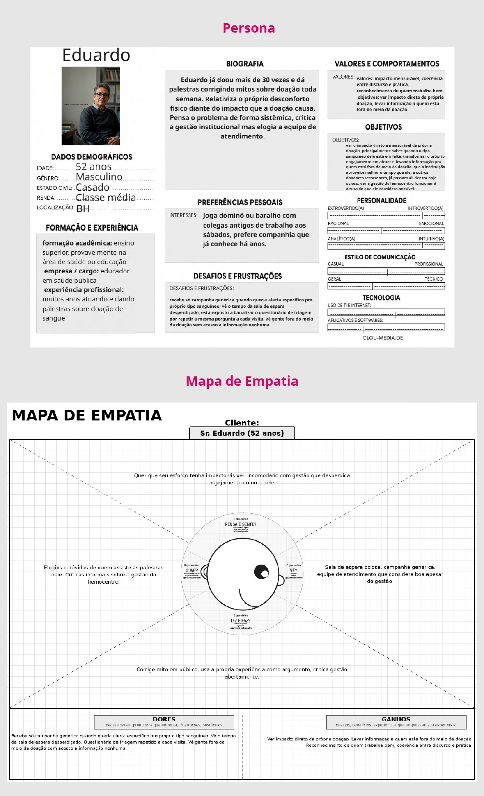

[⬅ Voltar ao índice](../README.md)

# Product Discovery

## Etapa de Entendimento

Para compreender com maior profundidade o problema, o grupo seguiu o processo proposto pela disciplina, que combina Design Thinking e desenvolvimento ágil. Na etapa de empatia foram produzidos a matriz CSD, o mapa de stakeholders, o roteiro e as entrevistas qualitativas com doadores e profissionais da área, e os highlights de pesquisa. Todos os artefatos estão registrados no [quadro do projeto no Miro](https://miro.com/app/board/uXjVHyO4Fhk=/).

A **Matriz de Alinhamento (CSD)** foi construída no início da fase de empatia. Nela, organizamos o que já sabíamos sobre o problema (certezas), o que achávamos, mas ainda não tínhamos confirmado (suposições), e o que precisávamos descobrir (dúvidas). As dúvidas e suposições serviram de base para o roteiro das entrevistas.

## Etapa de Definição

### Personas

A partir das entrevistas qualitativas, foram construídas três personas, cada uma representando um dos perfis de público-alvo. Junto com cada uma, há um mapa de empatia que organiza o que ela pensa e sente, ouve, vê, fala e faz, além das suas dores e dos ganhos que espera. As figuras foram retiradas do quadro do projeto no Miro.

#### Persona 1: Camila

Camila tem 26 anos, é solteira e trabalha como analista de marketing em uma empresa de médio porte, com jornada cheia durante a semana. Por causa da profissão, nota e reage a campanhas compartilhadas nas redes sociais. Viu uma campanha urgente de doação no Instagram, pesquisou o endereço do hemocentro, mas adiou a ida por causa da semana cheia. Tem medo de agulha e ficou insegura sobre se um remédio que toma às vezes poderia impedir a doação, o que quase a fez desistir.

**Objetivos e necessidades:** quer ajudar diante de um pedido urgente, mas só aceita se deslocar se tiver a confirmação prévia de que está apta. Valoriza a solidariedade, mas precisa se sentir segura antes de agir e prefere indicações informais a canais oficiais.

| Dimensão | Descrição |
| -------- | --------- |
| **Pensa e sente** | Teme perder a viagem e está insegura sobre a própria elegibilidade. Quer ajudar, mas sem o risco de ser barrada. |
| **Ouve** | Amigos que já doaram e posts do Instagram. Nunca recebe um aviso oficial direto. |
| **Vê** | Campanhas compartilhadas sem explicação do processo, apenas com apelo de urgência. |
| **Fala e faz** | Pesquisa, mas adia. Pergunta a um amigo antes de agir sozinha. |
| **Dores** | O medo de agulha pesa na decisão, mesmo querendo ajudar; a incerteza sobre o remédio a faz temer perder a viagem; não sabe quanto tempo o processo consome; só fica sabendo de urgências por posts compartilhados, nunca por aviso direto. |
| **Ganhos** | Ajudar diante de um pedido urgente, desde que tenha confirmação prévia de que está apta; sentir-se parte de uma causa sem precisar se engajar formalmente. |

#### Persona 2: Marcos

Marcos tem 36 anos, é casado, tem ensino médio completo e trabalha há mais de dez anos no comércio local, com horário fixo durante a semana. Mora em um bairro residencial perto do hospital onde a esposa é atendida, em Belo Horizonte. Doou sangue com frequência até perto da pandemia, quando parou. Voltou a doar porque a esposa precisou, por indicação do hospital. Age rápido quando a necessidade aparece, sem planejar com antecedência, e prefere seguir a indicação de quem já resolveu o mesmo problema a pesquisar por conta própria.

**Objetivos e necessidades:** quer garantir sangue disponível para uma pessoa específica que conhece e resolver isso rápido, sem burocracia. Valoriza a lealdade a quem precisa dele, prefere praticidade a elaboração e confia em indicações diretas.

| Dimensão | Descrição |
| -------- | --------- |
| **Pensa e sente** | Quer resolver rápido, sem burocracia. Está preocupado apenas com a pessoa que precisa dele. |
| **Ouve** | A indicação direta do hospital. Não recebe nada de amigos ou redes sociais. |
| **Vê** | A rotina do hemocentro pela primeira vez em muito tempo, depois de anos afastado. |
| **Fala e faz** | Fala pouco, age rápido e segue quem o indicou sem questionar. |
| **Dores** | Não sabe se vai conseguir doar até chegar ao local; entrou no processo sem conhecer nenhuma etapa; perde o vínculo com a doação assim que a necessidade específica desaparece; o horário de trabalho fixo dificulta sair sem planejar. |
| **Ganhos** | Garantir sangue disponível para a pessoa que conhece; resolver rápido e sem burocracia. |

#### Persona 3: Eduardo

Eduardo tem 52 anos, é casado, mora em Belo Horizonte e é educador em saúde pública. Já doou sangue mais de 30 vezes e dá palestras semanais corrigindo mitos sobre a doação. Relativiza o próprio desconforto físico diante do impacto que a doação causa. Pensa o problema de forma sistêmica: critica a gestão institucional, mas elogia a equipe de atendimento.

**Objetivos e necessidades:** quer ver o impacto direto e mensurável das suas doações e saber quando o seu tipo sanguíneo está em falta. Também quer transformar o próprio engajamento em alcance, levando informação a quem está fora do meio da doação, e ver a gestão do hemocentro aproveitar melhor o tempo dos doadores recorrentes. Valoriza impacto mensurável, coerência entre discurso e prática e reconhecimento de quem trabalha bem.

| Dimensão | Descrição |
| -------- | --------- |
| **Pensa e sente** | Quer que o seu esforço tenha impacto visível. Incomoda-se com uma gestão que desperdiça engajamento como o dele. |
| **Ouve** | Elogios e dúvidas de quem assiste às suas palestras e críticas informais sobre a gestão do hemocentro. |
| **Vê** | Sala de espera ociosa, campanhas genéricas e uma equipe de atendimento que considera boa, apesar da gestão. |
| **Fala e faz** | Corrige mitos em público, usa a própria experiência como argumento e critica a gestão abertamente. |
| **Dores** | Recebe só campanhas genéricas quando queria alertas específicos para o seu tipo sanguíneo; vê o tempo da sala de espera desperdiçado; responde ao mesmo questionário de triagem a cada visita; vê pessoas fora do meio da doação sem acesso a nenhuma informação. |
| **Ganhos** | Ver o impacto direto da própria doação; levar informação a quem está fora do meio da doação; reconhecimento de quem trabalha bem e coerência entre discurso e prática. |

#### Síntese das personas

Apesar de perfis diferentes, as três personas compartilham uma mesma necessidade: receber a informação certa no momento certo. Camila precisa saber se está apta antes de sair de casa; Marcos precisa saber se vai conseguir doar antes de sair e de um motivo para continuar doando quando a necessidade da esposa passar; Eduardo precisa de agilidade e de avisos direcionados ao seu tipo sanguíneo. Foi essa conclusão que guiou a proposta de valor do DoAção e, a partir dela, os requisitos apresentados no [Product Design](3_product-design.md).

---

[⬅ Anterior: Contexto](1_contexto.md) | [⬅ Voltar ao índice](../README.md) | [Próximo: Product Design ➡](3_product-design.md)
