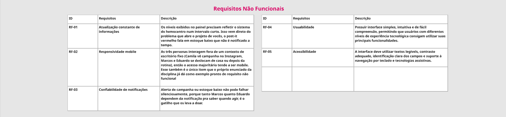

[⬅ Voltar ao índice](../README.md)

# Product Design

Nesse momento, transformamos os insights e validações obtidos em soluções tangíveis e utilizáveis. Essa fase envolve a definição de uma proposta de valor, a especificação e priorização das funcionalidades e a consequente criação de wireframes e protótipos que detalham a interface e a experiência do usuário.

## Proposta de Valor

A especificação do projeto foi elaborada a partir da proposta de valor de cada persona (Camila, Marcos e Eduardo), feita no Miro.

## Requisitos

Como algumas necessidades se repetiam entre as personas, elas foram reunidas em uma lista única, sem repetições. Cada requisito funcional indica a persona que o originou e a prioridade definida na etapa de priorização.

### Requisitos Funcionais

| ID | Requisito | Descrição | Persona | Prioridade |
| -- | --------- | --------- | ------- | ---------- |
| RF-01 | Cadastro e perfil do doador | Permitir que o usuário cadastre e edite seus dados pessoais, incluindo data de nascimento e tipo sanguíneo. | Todas | Alta |
| RF-02 | Pré-triagem online | Oferecer um questionário de elegibilidade (medicamentos, condições de saúde, intervalo desde a última doação) que informe ao usuário, antes do deslocamento, se ele pode doar. | Camila, Marcos | Alta |
| RF-03 | Agendamento online | Permitir que o usuário agende a doação em um hemocentro, escolhendo data e horário disponíveis. | Camila | Alta |
| RF-04 | Alertas segmentados | Enviar notificações apenas quando o tipo sanguíneo do usuário estiver com estoque baixo ou houver campanha direcionada a ele. | Marcos, Eduardo | Alta |
| RF-05 | Localização de hemocentros | Exibir os hemocentros mais próximos em um mapa, com endereço, distância e horário de funcionamento. | Camila | Alta |
| RF-06 | Histórico de triagem | Armazenar as respostas estáveis da última triagem para agilizar as próximas, pedindo ao usuário apenas a confirmação do que pode ter mudado. | Eduardo | Média |
| RF-07 | Controle de intervalo entre doações | Informar ao usuário quando ele poderá doar novamente e lembrá-lo quando o intervalo mínimo for cumprido. | Marcos, Eduardo | Média |
| RF-08 | Painel de impacto | Exibir ao usuário o número de doações realizadas, o volume doado e a estimativa de vidas ajudadas. | Eduardo | Média |
| RF-09 | Guia passo a passo da doação | Apresentar conteúdo informativo, em linguagem simples, sobre as etapas da doação e os critérios de aptidão. | Camila | Média |
| RF-10 | Pedidos de doação | Permitir que pacientes ou familiares publiquem pedidos de doação vinculados a um hospital e que outros usuários os visualizem e compartilhem. | Marcos | Baixa |
| RF-11 | Fórum de dúvidas | Permitir que usuários publiquem perguntas e recebam respostas de outros usuários ou da equipe. | Camila | Baixa |
| RF-12 | Quiz educativo | Oferecer quizzes interativos sobre doação, que podem ser usados inclusive durante a espera no hemocentro. | Camila, Eduardo | Baixa |
| RF-13 | Eventos e campanhas | Listar campanhas e eventos de doação, com data, local e número de participantes. | Eduardo | Baixa |
| RF-14 | Compartilhamento em redes sociais | Permitir que o usuário compartilhe campanhas e informações sobre doação nas redes sociais. | Eduardo | Baixa |
| RF-15 | Reengajamento pós-campanha | Enviar incentivos a quem participou de uma campanha específica, para que continue doando depois dela. | Marcos | Baixa |

### Requisitos Não-Funcionais

Os requisitos não funcionais definem qualidades que o sistema deve ter, independentemente da funcionalidade utilizada.

| ID | Requisito | Descrição |
| -- | --------- | --------- |
| RNF-01 | Responsividade | A aplicação deve se adaptar a telas de celulares, tablets e computadores. |
| RNF-02 | Usabilidade | As tarefas principais (pré-triagem e agendamento) devem poder ser concluídas sem treinamento, com linguagem simples e sem termos técnicos. |
| RNF-03 | Segurança e privacidade | Dados pessoais e de saúde devem ser protegidos, com senhas armazenadas de forma criptografada, em conformidade com a Lei Geral de Proteção de Dados (LGPD). |
| RNF-04 | Disponibilidade | A aplicação deve estar publicada em um ambiente acessível publicamente na internet e disponível 24 horas por dia, 7 dias por semana. |
| RNF-05 | Desempenho | As páginas principais devem carregar em até 3 segundos em uma conexão móvel 4G. |
| RNF-06 | Acessibilidade | As telas devem ter contraste adequado, textos alternativos em imagens e tamanho de fonte legível. |

### Restrições

As restrições são limitações impostas ao projeto que a equipe não pode alterar.

| ID | Restrição |
| -- | --------- |
| R-01 | O projeto deve ser desenvolvido e entregue dentro do calendário do Trabalho Interdisciplinar 2, no segundo semestre de 2026. |
| R-02 | O sistema deve ser desenvolvido com as tecnologias definidas pela disciplina (aplicação web, API, banco de dados e hospedagem em plataforma PaaS) e versionado no repositório GitHub da disciplina. |
| R-03 | Nesta versão não haverá integração com os sistemas oficiais da Fundação Hemominas; os dados de hemocentros e estoques serão cadastrados ou simulados pela equipe. |
| R-04 | A pré-triagem online tem caráter apenas orientativo e não substitui a triagem clínica realizada presencialmente no hemocentro. |

## Priorização de Requisitos

Os requisitos foram priorizados no Miro usando uma matriz com quatro categorias: **obrigatórias** (sem elas o produto não resolve o problema), **importantes** (agregam muito valor, mas o produto funciona sem elas), **desejáveis** (melhoram a experiência) e **opcionais** (podem ficar para versões futuras). O critério principal foi o quanto cada funcionalidade resolve as dores mais citadas nas entrevistas: a dúvida sobre a aptidão, a falta de avisos e a dificuldade de encaixar a doação na rotina.

O resultado está organizado no Kanban de funcionalidades abaixo. Cada coluna corresponde a uma categoria, e a ordem de implementação segue da esquerda para a direita.

| Obrigatórias | Importantes | Desejáveis | Opcionais |
| ------------ | ----------- | ---------- | --------- |
| RF-01 Cadastro e perfil do doador | RF-06 Histórico de triagem | RF-10 Pedidos de doação | RF-13 Eventos e campanhas |
| RF-02 Pré-triagem online | RF-07 Controle de intervalo entre doações | RF-11 Fórum de dúvidas | RF-14 Compartilhamento em redes sociais |
| RF-03 Agendamento online | RF-08 Painel de impacto | RF-12 Quiz educativo | RF-15 Reengajamento pós-campanha |
| RF-04 Alertas segmentados | RF-09 Guia passo a passo da doação | | |
| RF-05 Localização de hemocentros | | | |

As funcionalidades obrigatórias formam o fluxo central do DoAção: o usuário se cadastra, verifica se está apto, encontra um hemocentro, agenda a doação e passa a receber avisos quando for necessário. As importantes reforçam a recorrência, que é o segundo objetivo do projeto. As desejáveis e opcionais tratam de comunidade e engajamento, e serão implementadas conforme o tempo disponível nas sprints.

## Projeto de Interface

Artefatos relacionados com a interface e a interação do usuário na proposta de solução. Os wireframes e o user flow foram feitos no [Figma](https://www.figma.com/design/njJzqfUmrD8CigO7nbO1EH/Doação-de-sangue-Wireframes-e-fluxo).

### User Flow

✅ [User flow do projeto (Figma)](https://www.figma.com/design/njJzqfUmrD8CigO7nbO1EH/Doa%C3%A7%C3%A3o-de-sangue-%E2%80%94-Wireframes-e-fluxo?node-id=12-13)

[PREENCHER: exportar o diagrama do user flow do Figma para `docs/images/userflow.png` e exibi-lo aqui com ``]

### Design System

[PREENCHER: documentar a paleta de cores, a tipografia, os ícones (Bootstrap Icons) e os componentes (botões, cards, navbar) usados na aplicação]

### Wireframes

Estes são os protótipos de telas do sistema.

✅ [Wireframes do projeto (Figma)](https://www.figma.com/design/njJzqfUmrD8CigO7nbO1EH/Doa%C3%A7%C3%A3o-de-sangue-%E2%80%94-Wireframes-e-fluxo?node-id=0-1)

[PREENCHER: exportar as telas principais do Figma para `docs/images/` e incluí-las aqui, cada uma com título e descrição]

### Protótipo Interativo

✅ [Protótipo Interativo (MarvelApp)](https://marvelapp.com/prototype/d4f07df/screen/99058085)

---

[⬅ Anterior: Product Discovery](2_product-discovery.md) | [⬅ Voltar ao índice](../README.md) | [Próximo: Minimundo ➡](4_minimundo.md)
